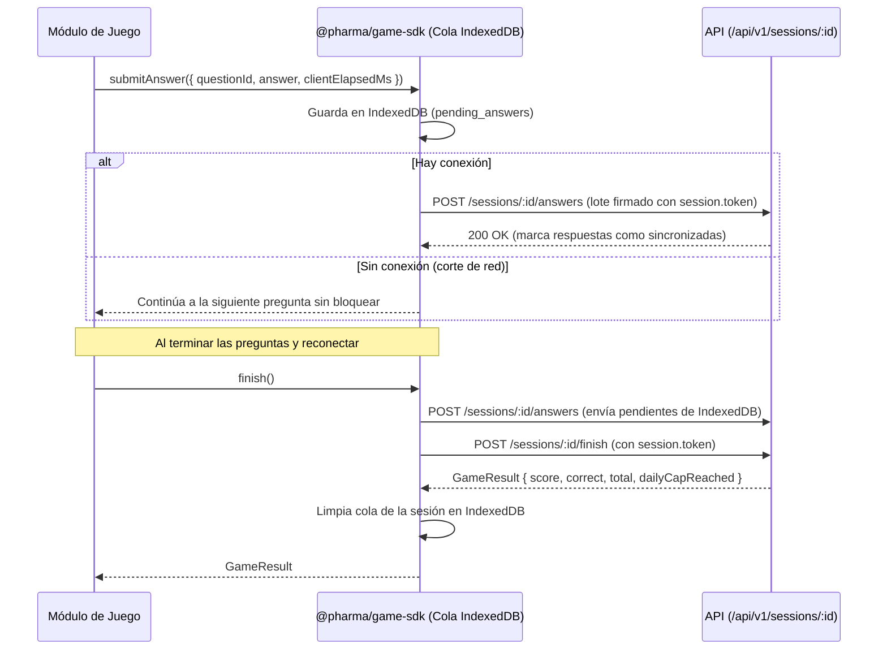

# Contrato de Integración de Juegos (`@pharma/game-sdk`)

## 1. Propósito y Alcance

El paquete `@pharma/game-sdk` define el contrato estricto entre la **PWA contenedora** (`@pharma/pwa`) y cualquier **módulo de juego** (`@pharma/game-trivia`, `@pharma/game-true-false` o futuros moldes).

Principios de diseño no negociables (CLAUDE.md §4 y §8):

1. **El cliente nunca calcula el puntaje**: Las preguntas que recibe el juego (`PublicQuestion[]`) jamás incluyen `correctAnswer`. El servidor valida las respuestas y devuelve `GameResult`.
2. **Resiliencia ante cortes de red móvil**: Si la conexión cae a mitad de la partida, `ctx.submitAnswer()` guarda cada respuesta en `IndexedDB` (con respaldo en memoria si el navegador está en modo privado restringido) y las sincroniza en lote antes de ejecutar `POST /api/v1/sessions/:id/finish`.
3. **Tematización 100 % por configuración**: Un juego nuevo de la misma mecánica no requiere escribir código; recibe `ctx.theme` (`primary`, `secondary`, `logoUrl`, `brandName`), `ctx.locale` y `ctx.terms`.
4. **Accesibilidad y gama baja**: Objetivos táctiles ≥ 44 px, respeto automático a `prefers-reduced-motion`, sonido opcional desactivable y peso total ≤ 1,5 MB.

---

## 2. Interfaces del Contrato

```ts
export interface GameModule {
  manifest: {
    id: string;
    mechanic: 'MULTIPLE_CHOICE' | 'TRUE_FALSE';
    version: string;
    maxBundleKb: number;
  };
  mount(container: HTMLElement, ctx: GameContext): GameHandle;
}

export interface GameContext {
  session: { id: string; token: string; expiresAt: string };
  questions: PublicQuestion[]; // SIN respuesta correcta
  theme: { primary: string; secondary: string; logoUrl: string; brandName: string };
  locale: string; // es-CO | es-EC | es-PE
  terms: Record<string, string>; // términos locales
  limits: { secondsPerQuestion: number; totalSeconds: number };
  submitAnswer(a: { questionId: string; answer: string; clientElapsedMs: number }): void; // se encola offline
  finish(): Promise<GameResult>; // el SDK envía lo pendiente y recibe el puntaje del servidor
  track(event: string, data?: Record<string, unknown>): void;
}

export interface GameHandle {
  unmount(): void;
}

export interface GameResult {
  score: number;
  correct: number;
  total: number;
  dailyCapReached: boolean;
  rankPosition?: number;
}
```

---

## 3. Flujo de Sincronización Offline (`createGameContext`)



**Tiempos (ADR-029).** `clientElapsedMs` es informativo: el servidor mide cuándo llega cada respuesta y con eso calcula el bono de velocidad y detecta respuestas demasiado rápidas. Un juego **no** debe agrupar respuestas a propósito ni enviarlas en ráfaga: el SDK ya envía una por una con conexión y en un solo lote al reconectar, y así lo espera el servidor.

---

## 4. Ejemplo Mínimo de Juego

```ts
import type { GameContext, GameHandle, GameModule } from '@pharma/game-sdk';

const minimalTrueFalseGame: GameModule = {
  manifest: {
    id: 'minimal-tf',
    mechanic: 'TRUE_FALSE',
    version: '1.0.0',
    maxBundleKb: 64,
  },
  mount(container: HTMLElement, ctx: GameContext): GameHandle {
    let idx = 0;
    let startedAt = Date.now();

    function render() {
      const q = ctx.questions[idx];
      if (!q) {
        container.textContent = 'Calculando puntaje…';
        void ctx.finish().then((res) => {
          container.textContent = `${ctx.theme.brandName}: ${res.score} pts (${res.correct}/${res.total})`;
        });
        return;
      }
      startedAt = Date.now();
      container.innerHTML = `
        <div style="border-left: 4px solid ${ctx.theme.primary}; padding: 12px;">
          <p>${q.prompt}</p>
          <button data-id="TRUE" style="min-height:48px">Verdadero</button>
          <button data-id="FALSE" style="min-height:48px">Falso</button>
        </div>
      `;
      container.querySelectorAll<HTMLButtonElement>('button[data-id]').forEach((btn) => {
        btn.onclick = () => {
          ctx.submitAnswer({
            questionId: q.id,
            answer: btn.dataset.id!,
            clientElapsedMs: Math.max(1, Date.now() - startedAt),
          });
          idx += 1;
          render();
        };
      });
    }

    render();
    return {
      unmount() {
        container.innerHTML = '';
      },
    };
  },
};

export default minimalTrueFalseGame;
```
